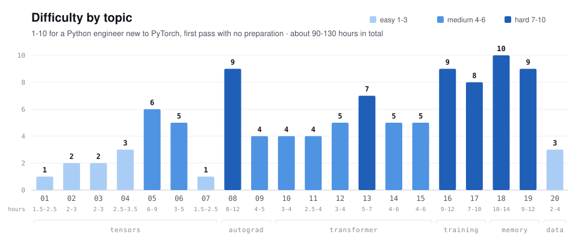

# PyTorch exercises for LLM developers

Twenty files of PyTorch drills, from tensor basics to a KV cache and FlashAttention-style blockwise attention.
Each file holds function stubs per one topic and the tests to check your implementation.
Replace `raise NotImplementedError` with your code until all tests are green.


**Theory:** [almaz-kg.github.io/pytorch-exercises-for-llm-developers](https://almaz-kg.github.io/pytorch-exercises-for-llm-developers/), or the same Markdown in [`theory/`](theory/README.md).

## Quick start

You need [uv](https://docs.astral.sh/uv/). It brings Python 3.12 or 3.13 on its own.

```sh
uv sync
uv run pytest test_01_tensor_basics.py -x
```

An untouched file will fail with `NotImplementedError`. That is the starting point, not a broken setup.

## How hard is it?

<picture>
  <source media="(prefers-color-scheme: dark)" srcset="assets/difficulty-dark.svg">
  
</picture>

About 115 hours for a first pass, if you are at home in Python and arrays but new to PyTorch.
A second pass should go three to five times faster.

## Topics

Later topics lean on earlier ones, so go in order.
01-07 are tensor mechanics, 08-14 the transformer brick by brick starting from `nn.Module`, 15-17 training and inference starting from autograd, 18-19 memory and modern tricks, 20 data plumbing.

| # | Topic | Stubs | What it drills |
| --- | --- | ---: | --- |
| 01 | [Tensor basics](theory/01_tensor_basics.md) | 15 | dtype, shape, memory, in-place, copy vs view |
| 02 | [Shapes and views](theory/02_shapes_and_views.md) | 19 | reshape, permute, contiguous, splitting heads, expand vs repeat |
| 03 | [Broadcasting](theory/03_broadcasting.md) | 14 | right-aligned shapes, masks, ALiBi, pairwise distances |
| 04 | [Reductions](theory/04_reductions.md) | 18 | dim and keepdim, masked means, logsumexp, gradient norms |
| 05 | [Indexing and gather](theory/05_indexing_and_gather.md) | 15 | embedding lookup, gathering logits, scatter, top-k mask |
| 06 | [Matrix multiplication](theory/06_matmul.md) | 13 | linear and its backward by hand, LoRA, FLOPs |
| 07 | [einsum and einops](theory/07_einsum_and_einops.md) | 20 | the whole attention algebra in one line |
| 08 | [nn.Module](theory/08_nn_module.md) | 19 | Parameter vs buffer, state_dict, init, weight tying, hooks |
| 09 | [Softmax and loss](theory/09_softmax_and_loss.md) | 11 | stable softmax, cross-entropy from scratch, KL |
| 10 | [Normalization](theory/10_normalization.md) | 11 | LayerNorm, RMSNorm, float32 upcast, pre-norm vs post-norm |
| 11 | [Activations and FFN](theory/11_activations_and_ffn.md) | 12 | GELU, SiLU, SwiGLU, sizing d_ff |
| 12 | [Embeddings and RoPE](theory/12_embeddings_and_rope.md) | 11 | sinusoids, rotations, relative positions |
| 13 | [Attention](theory/13_attention.md) | 14 | scaled dot-product, causal mask, MHA, GQA, sliding windows, sinks |
| 14 | [Transformer block](theory/14_transformer_block.md) | 12 | the pre-norm block, the full model, initial loss of log(V) |
| 15 | [Autograd](theory/15_autograd.md) | 18 | gradient accumulation, vjp, custom `autograd.Function`, STE, RMSNorm backward |
| 16 | [Training loop](theory/16_training_loop.md) | 11 | AdamW from scratch, cosine schedule, clipping, accumulation |
| 17 | [Generation](theory/17_sampling_and_kv_cache.md) | 15 | temperature, top-k, top-p, EOS, KV cache vs a full pass |
| 18 | [Flash and memory](theory/18_flash_and_memory.md) | 10 | online softmax, blockwise attention, chunked CE, checkpointing |
| 19 | [Advanced mechanisms](theory/19_advanced_architectures.md) | 17 | MLA, Gated DeltaNet, modern MoE, n-gram memory, speculative decoding |
| 20 | [Data and checkpoints](theory/20_data_and_batching.md) | 10 | memmap batches, padding, packing with document masks, save and load |

## How do I work through a topic?

1. Read `theory/NN_<topic>.md`.
2. Run the tests for that file and fix the first failure. Each test covers one stub.
3. Stuck? `solutions/` has a reference for every topic.
4. Come back in a month, roll the topic back and do it again.

```sh
uv run pytest test_13_attention.py -x            # one file, stop at the first failure
uv run pytest -k rope                            # one test by name
uv run pytest test_13_attention.py -rs           # what each skipped test is waiting for
SOLUTIONS=1 uv run pytest test_13_attention.py   # run the same tests against solutions/

uv run python reset.py                           # status: how many stubs are left per topic
uv run python reset.py 13                        # roll topic 13 back to its template
uv run python reset.py --diff 13                 # your version vs the template
```

## Where do my solutions go?

The `test_NN_*.py` files in the root are your working copies.

`reset.py` does not lose work: before it overwrites a file, it moves your version to `attempts/<date_time>/`.
With `--no-archive` parameter it will skip the copy.
`uv run python reset.py --restore attempts/<date_time>/test_13_attention.py` brings it back.

## Rules

- No Python loops over tensor elements, unless the docstring allows one.
- Do not touch the tests. A test bent to fit your code teaches nothing.
- Formula on paper first, code second. Especially in 15, 18 and 19.
- Keep the module names from the docstrings (`q_proj`, `w1`, `ln1`, `lm_head`, no biases). Tests check `state_dict` keys.

## What about AI assistants?

An assistant in your editor fills any of these files in seconds, and then you have learned nothing.
[`AGENTS.md`](AGENTS.md) tell coding agents to explain, review and debug through questions instead of writing the stubs.
That holds only as long as you do not overrule them.

## License

[MIT](LICENSE).
